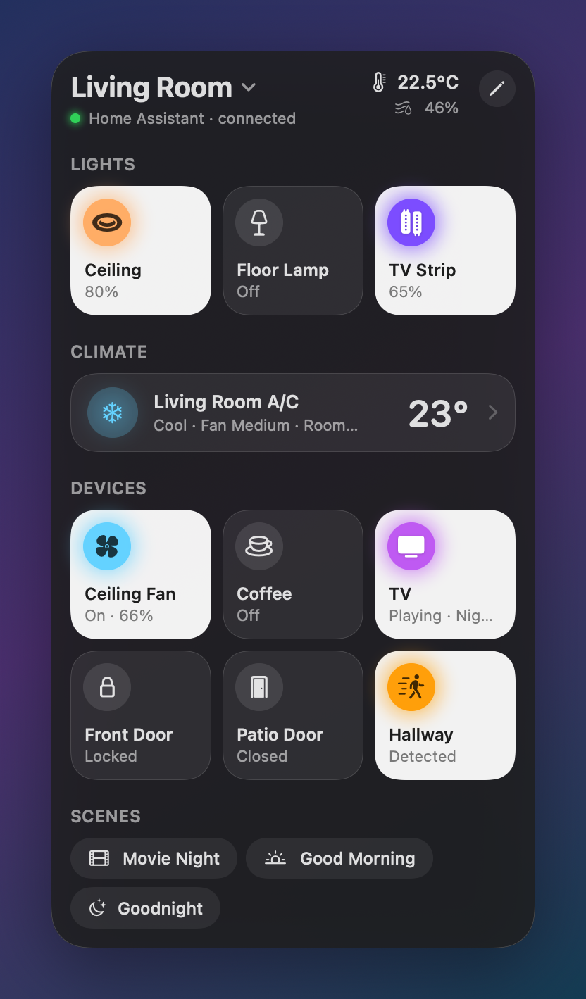
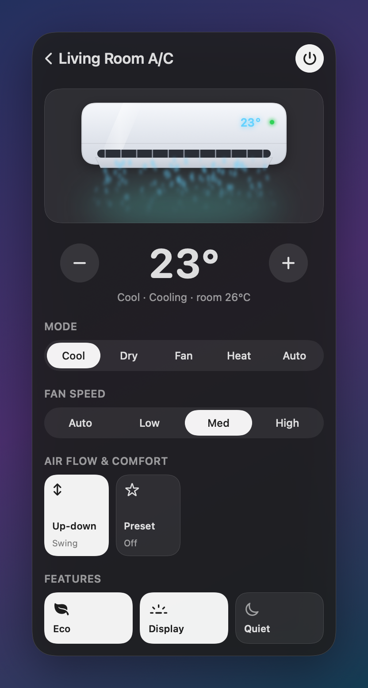
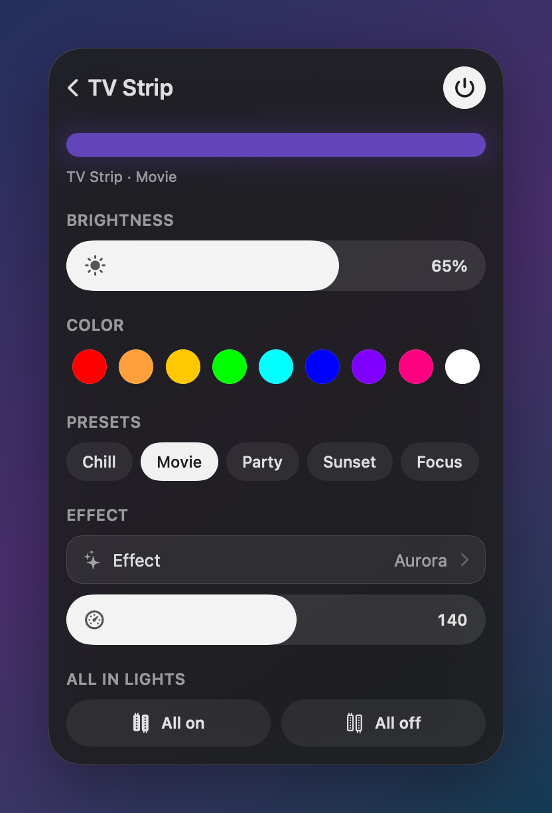
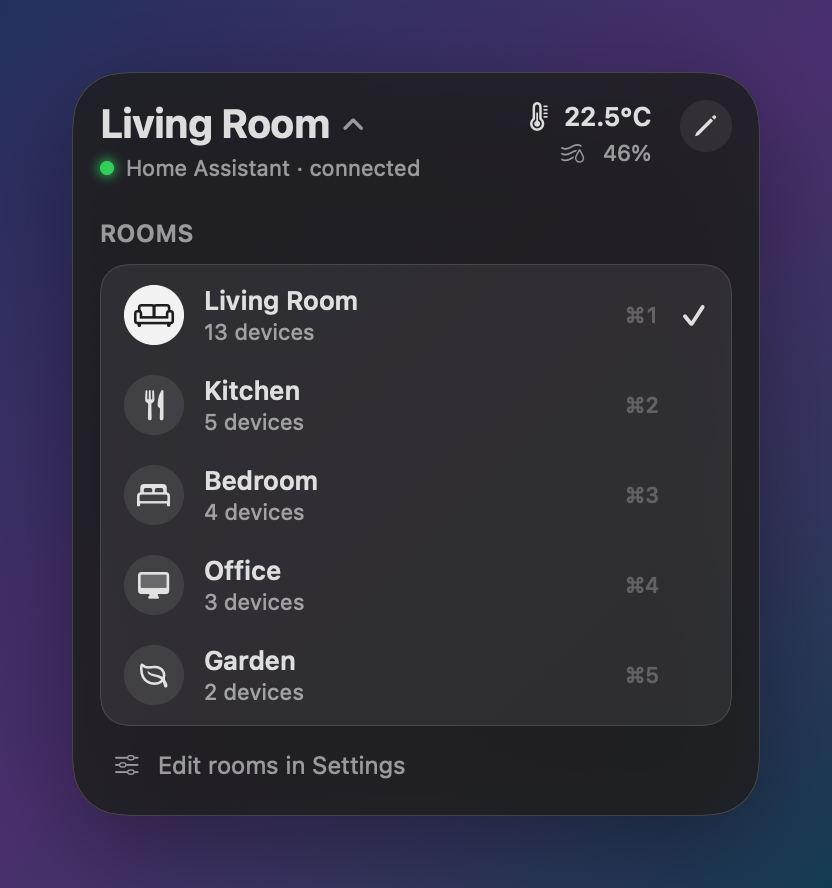
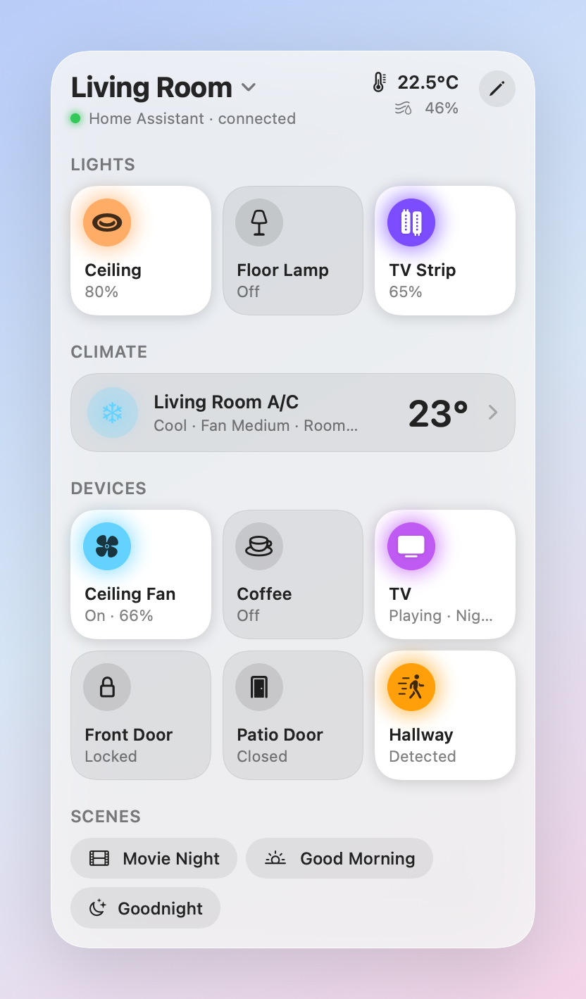

# HomePanel

A native macOS menu bar app for [Home Assistant](https://www.home-assistant.io). Click the house in the menu bar and a Liquid Glass panel drops down with your rooms, lights, switches, climate, media and more, all live over Home Assistant's WebSocket API.

<p align="center">
  
  
  
</p>
<p align="center">
  
  
</p>

HomePanel is an independent project and isn't affiliated with Home Assistant or the Open Home Foundation.

## Features

- **Rooms.** Build rooms from your Home Assistant Areas in one step, then switch between them in the panel or with ⌘1–⌘9.
- **Your devices, your layout.** Add any entity, group cards into sections shown as tiles, rows or pills, rename them, change icons, reorder, hide. Edit in Settings → Rooms, or right in the panel with the pencil (⌘E).
- **Rich device screens** that show only what each device supports:
  - lights: brightness, color, white temperature, effects, plus WLED-style presets and effect speed
  - climate: modes, target or heat/cool range, fan, swing and presets, plus an animated A/C unit
  - covers, fans, media players (artwork, transport, volume, sources), locks (tap twice to unlock), alarm panels (with a code pad), sensors, selects and numbers
- **Related entities.** A card can carry the extra entities that belong to the same device (an A/C's air-flow selects, a light's preset select, a switch's power-on behaviour) and they show up on its screen. The room builder finds these for you.
- **Fast and light.** Connects only while the panel or Settings is open (plus a minute after), subscribes only to the room you're looking at, and updates instantly.
- **Private.** Talks only to your Home Assistant. The access token is kept in your Keychain. No analytics, no accounts.

## Download

Get the latest **HomePanel-x.y.z.dmg** from [Releases](../../releases/latest), open it and drag HomePanel to Applications.

The release builds aren't notarized by Apple (that needs a paid developer account), so the first time you open HomePanel macOS blocks it. Click **Done**, then go to **System Settings → Privacy & Security** and click **Open Anyway** next to the HomePanel message. You only do this once. After an update, macOS may ask once whether HomePanel can use its saved token in your keychain; choose **Always Allow**.

Rather not run an un-notarized app? Build it yourself, below.

## Requirements

- macOS 26 or later
- Xcode 26 or later, and [XcodeGen](https://github.com/yonaskolb/XcodeGen)
- Home Assistant with a [long-lived access token](https://www.home-assistant.io/docs/authentication/#your-account-profile)
- An Apple ID signed in to Xcode. A free Personal Team is enough.

## Build from source

1. Get the code and the project generator:

   ```bash
   git clone <this repository> HomePanel
   cd HomePanel
   brew install xcodegen
   ```

2. Create your signing settings from the template:

   ```bash
   cp Config/Signing.xcconfig.template Config/Signing.xcconfig
   ```

   Open `Config/Signing.xcconfig` and set:
   - `DEVELOPMENT_TEAM` to your team ID. Sign in under Xcode → Settings → Accounts; the 10-character ID is shown next to your team.
   - `BUNDLE_ID_PREFIX` to something of your own, like `com.yourname`.

   This file is git-ignored, so your team ID stays out of the repository.

3. Generate the Xcode project and build:

   ```bash
   xcodegen generate
   xcodebuild -project HomePanel.xcodeproj -scheme HomePanel -configuration Release \
     -derivedDataPath build.noindex -allowProvisioningUpdates build
   ```

   Or open `HomePanel.xcodeproj` and press Run. `-allowProvisioningUpdates` lets Xcode create the provisioning profile the app needs for its Keychain and App Group.

4. Install it:

   ```bash
   ditto build.noindex/Build/Products/Release/HomePanel.app /Applications/HomePanel.app
   open /Applications/HomePanel.app
   ```

## First run

Settings opens with a short setup:

1. **Server.** HomePanel looks for Home Assistant on your network. Pick it, or type its address (for example `http://homeassistant.local:8123`). macOS asks for Local Network access the first time; allow it.
2. **Token.** In Home Assistant, open your profile → Security → Long-lived access tokens → Create token, and paste it in.
3. **Rooms.** Tick the Areas you want as rooms. HomePanel builds each one with its devices.

Then click the house in the menu bar. Right-click it (or Control-click) for **Settings…** and **Quit HomePanel**.

## Customising

- **Settings → Rooms:** add rooms (from Areas or empty), rename them and pick icons, choose the two header readings, add sections and devices, and edit any card (name, icon, type, section, related entities). **Rebuild…** refreshes a room from its Area.
- **In the panel:** press the pencil (⌘E). Drag tiles to reorder, including into another section, and use the eye to hide or show them. **Customise…** jumps to the Rooms editor.
- **Settings → General → Export / Import** saves your layout to a `.homepanel.json` file, for backups or to move it to another Mac.
- **"Turn off after" for switches:** see [`docs/ha-switch-timers.yaml`](docs/ha-switch-timers.yaml) for the Home Assistant timer and automation it uses.

### Keyboard

| Keys | Does |
|---|---|
| ⌘1–⌘9 | Switch room |
| ⌘E | Edit the current room |
| ⌘[ | Back |
| ⌘, | Settings (or right-click the menu bar icon) |
| Arrow keys, Space, Return | Move between tiles, do a tile's quick action, open it |
| Esc | Leave edit mode, close the room list, or go back |

## Troubleshooting

- **"Not on home network"**: HomePanel can't reach the address in Settings. Check it in a browser on this Mac, and that Local Network access is allowed in System Settings → Privacy & Security → Local Network.
- **"Token rejected"**: create a new long-lived token and paste it in Settings → General.
- **"HomePanel can't be opened" / "Apple could not verify…"** (downloaded DMG): see [Download](#download). Use **Open Anyway** in System Settings → Privacy & Security.
- **Signing errors when building**: make sure `Config/Signing.xcconfig` has your team ID, you're signed in to Xcode with that team, and you pass `-allowProvisioningUpdates` (or build once from Xcode).
- **A card says Home Assistant doesn't have this entity**: the entity was renamed or removed in HA. Remove the card, or use **Add Device…** to pick its new ID.

## Development

```bash
cd Packages/HAKit && swift test     # model, config, catalog and layout tests
Tools/make-dmg.sh                    # ad-hoc signed universal DMG in build.noindex/release
Tools/make-screenshots.sh            # re-render docs/screenshots from a made-up demo home
```

Releases are built by GitHub Actions: bump `MARKETING_VERSION` in `project.yml`, then push a matching tag (`git tag v1.2.0 && git push origin v1.2.0`). The workflow runs the tests, builds the DMG and publishes the release with [`docs/release-notes.md`](docs/release-notes.md).

| Path | What |
|---|---|
| `Packages/HAKit` | WebSocket client, entity store, registry catalog, layout config and generator, device helpers, Keychain |
| `HomePanel/Panel` | The menu bar panel: home screen, device screens, A/C animation, edit mode |
| `HomePanel/Settings` | Settings window: connection, Rooms editor, setup wizard |
| `Config/` | Signing template, entitlements for the ad-hoc DMG build |
| `Tools/` | DMG build, screenshot and app icon scripts |
| `HomePanel/Demo` | The demo home used for screenshots (debug builds only) |
| `project.yml` | XcodeGen spec (the `.xcodeproj` is generated, not committed) |

See [CONTRIBUTING.md](CONTRIBUTING.md) for how to send changes.

## License

[MIT](LICENSE)
